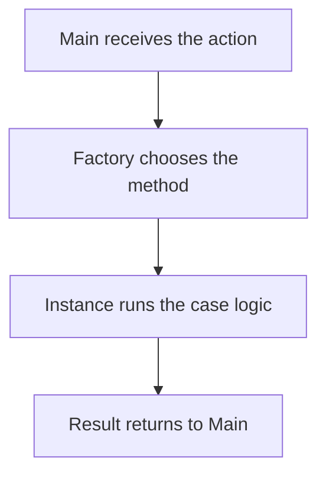
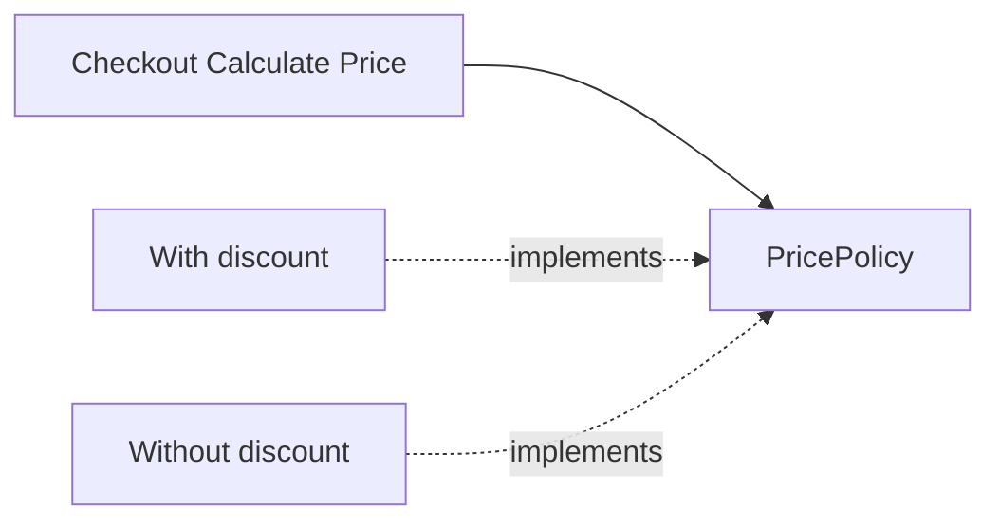
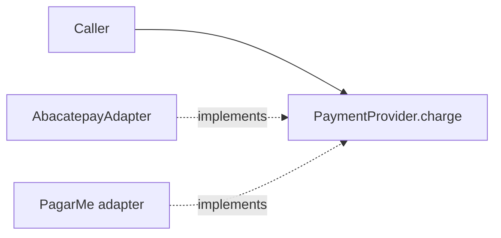

# Design Patterns

The harness uses four patterns on purpose: **Factory**, **Singleton**, **Strategy**, and **Adapter**. Each one has two examples: one from the checkout and payments domain in Pedro's drawing (`Sobre Design Patterns`), and the same shape applied to agents and tools.

This note is part of the retrieval corpus of `vault_retrieve` ([[MCP]]), so every section is written to stand on its own.

## Overview

| Pattern | Use it when | Domain example | Harness example |
|---|---|---|---|
| Factory | Main must pick an implementation from the action | factory returns the handler for the action | task type → role + tier |
| Singleton | a service lives as long as the process and has no identity of its own | one purchase register | one vault index per MCP process |
| Strategy | the behavior changes and the call shape does not | `PricePolicy.calculate(price)` | `TaskStrategy.run(brief)` |
| Adapter | the foreign API is not ours | `PaymentProvider.charge` | one MCP tool contract for every client |

## Factory

Main does not build the specialist by hand and does not branch on concrete classes. A factory receives the action and returns the object that can perform it. The system depends on the factory, not on one object type.

**Domain, as drawn.** Main receives the action. A condition decides which method to use. The method creates the instance, and the instance performs the action using the logic for that case and returns the result.

**Harness.** The Main Agent sends the task type to one routing function. That function returns the role and the tier (see [[HARNESS/LLM MODELS/models]]). Adding a role means adding a branch inside the factory, not a new if/else in every caller.

## Singleton

One instance per running process. Other classes get it through a static getter. They do not construct their own copy. When the process stops, the instance is gone.

Do not persist the live object in a database. Persist facts (a note, a row, a commit), never object identity.

**Domain, as drawn.** One purchase register instance. Ana's purchase and Bia's purchase both use it: the register has two users but only one instance, so both purchases share the same methods and state.

**Harness.** One vault index and one MCP client per process. In `hermes-vault`, the index cache in `.mcp/src/search.mjs` is module-level state: built on first use, reused by every tool call, rebuilt when the files on disk change, and gone when the server stops. A second agent in the same process reuses it. A new process builds it again. Session memory is not a singleton stored in Postgres.

## Strategy

One contract, many behaviors. The caller holds the contract and passes the context. Each behavior implements the contract. The caller has no if/else chain for policies.

**Domain, as drawn.** `PricePolicy.calculate(price)` is the contract. `WithDiscount` and `WithoutDiscount` implement it. Checkout calls the method and does not inspect which policy it holds.

**Harness.** Review, implement, research, and summarize are strategies behind one `TaskStrategy` contract (`run(brief) -> result`). The orchestrator picks the strategy through the factory. It does not contain the strategy's steps.

## Adapter — today's bottleneck

The drawing marks Strategy and Adapter as today's real bottleneck. An adapter wraps a foreign interface so it obeys a contract we own. The caller depends only on our contract and never needs to know any provider's API.

**Domain, as drawn.** `PaymentProvider.charge` completes a payment. `AbacatepayAdapter implements PaymentProvider`, and the PagarMe adapter implements it too. The checkout class never imports a provider SDK. Adding a provider means a new adapter, not a new branch in checkout.

**Harness, same shape.** Cursor, Claude Desktop, OpenCode, and OpenBot each keep their own MCP config. The vault server exposes one tool contract, and callers use `vault_search`, `vault_retrieve`, and `vault_read` without special-casing the client. Model vendors will get the same treatment later, behind a `ModelProvider` port. Until the model catalog is real, the port's model id stays `TBD`.

## Rules for using the patterns

- Use **Factory** when Main must pick an implementation from the action.
- Use **Strategy** when the behavior changes and the call shape does not.
- Use **Adapter** when the foreign API is not ours. Apply it first on every new integration.
- Use **Singleton** only for process-lifetime services with no identity of their own. Never use it for user data, and never write the instance to the database.
- Do not stack all four patterns in a small script. As [[Process/code-architecture]] already says, do not add layers that add no value.

## Review checklist

- [ ] Callers depend on a contract (port), not on a concrete provider.
- [ ] A new provider or policy is a new file, not a new branch in the caller.
- [ ] Each singleton is process-scoped and never persisted as an object.
- [ ] No pattern was added where a plain function is enough.

## Anti-patterns

| Anti-pattern | Effect |
|---|---|
| if/else chain on provider or policy names | every new case edits the caller |
| Provider SDK imported in the domain | the dependency points outward |
| Singleton holding user data | leaks state between users and sessions |
| Live instance saved to the database | stale identity, broken on restart |
| Factory for a single implementation | indirection with no benefit |

Related: [[Process/code-architecture]], [[HARNESS/HARNESS MAIN/architecture]], [[Process/code-review]].
