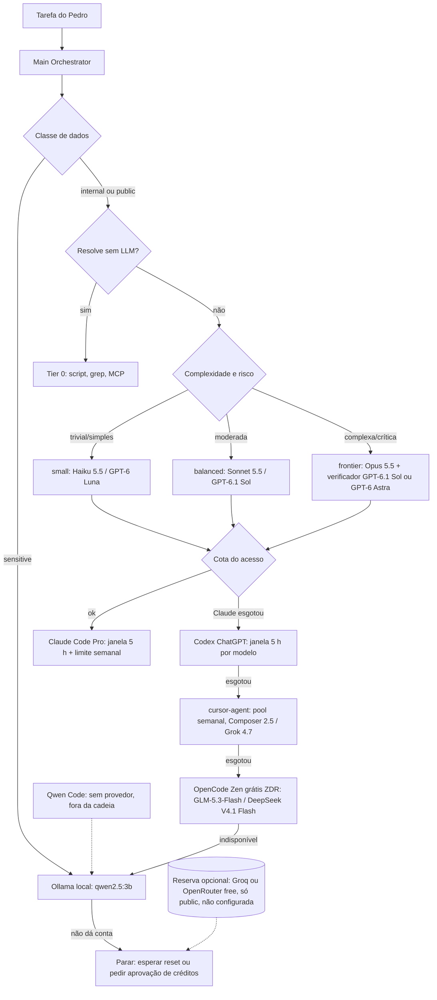

# Model Catalog — qual modelo usar para cada tarefa

Mapeia os tiers abstratos de [[Model-Router]] e [[Model-Routing-Policy]] (`tier0/local/small/balanced/frontier`) para **modelos reais que o Pedro consegue usar hoje no Mac**. O Main Orchestrator lê isto por `get_model_routing_policy` (`task=…` ou `view=catalog|matrix|rules`), sem tool nova. Há uma ficha por modelo em `Models/` (type `model-card`).

> [!warning] Fotografia datada
> Rankings, cotas e listas de modelos são uma **fotografia de 29/10/2026 (~23h BRT)**. Mudam todo mês: GPT-5.5 saiu do Codex com login ChatGPT em 14/10/2026, DeepSeek V4 Flash foi descontinuado no OpenCode em 26/10/2026. **Revisão mensal** (1º dia útil do mês) ou antes, se um provedor anunciar aposentadoria. A tool avisa `VENCIDO` quando `snapshot_date` passa de `review_every_days`.

## Núcleo e reserva
- **Núcleo**: os acessos que já existem no Mac. São eles que preenchem primário e fallback na matriz: Claude Code (Pro), Codex (login ChatGPT), cursor-agent, OpenCode (modelos grátis ZDR + Ollama), Qwen Code (casca sem provedor) e Ollama local.
- **Reserva opcional**: APIs grátis externas (Groq, OpenRouter `:free`, Mistral). **Não configuradas**, fora da cadeia padrão, só para dados `public` e só com aprovação.



## Cotas por acesso
Limites lidos nas páginas oficiais em 29/10/2026. Plano do ChatGPT: **ChatGPT Plus (confirmado pelo Pedro em 29/10/2026)**. O plano do Cursor **não foi verificado**. Treino: Pedro não sabe se o treino está desligado (29/10/2026) — Cofre bloqueado até confirmação.

| acesso | plano_verificado | limite | ao_esgotar |
|---|---|---|---|
| claude-code | Pro (login confirmado) | janela móvel de 5 h + limite semanal, compartilhados entre claude.ai, Desktop e Claude Code; Opus gasta bem mais que Sonnet; Fable só com usage credits | 1) trocar para Sonnet/Haiku se ainda houver folga; 2) ir para codex; 3) usage credits ou upgrade para Max só com aprovação do Pedro |
| codex | ChatGPT Plus (confirmado pelo Pedro em 29/10/2026) | Plus, mensagens locais por 5 h: Astra 5–45, 6.1 Sol 15–160, 6.1 Terra 35–285, Luna 350–3.000; pode haver limite semanal; Pro sem janela de 5 h; trocar de modelo não devolve cota do pool; modo Fast gasta 2,5× | ver `/status`; ir para cursor-agent; créditos só com aprovação |
| cursor-agent | logado; plano não verificado (lista 270 variantes, incluindo de terceiros) | planos novos: pool semanal compartilhado com Grok; Plus só modelos do Cursor (Grok, Composer); Premium ou mais: terceiros ao preço de API via crédito; planos legados Pro/Pro+: pool mensal | esperar o reset semanal; ir para opencode; crédito só com aprovação |
| opencode | sem login de provedor pago; Ollama configurado | modelos Zen grátis por tempo limitado, só dentro do OpenCode; limites de taxa não publicados na página lida | ir para ollama |
| qwen-code | sem provedor (tier grátis OAuth encerrado em 15/04/2026) | — | fora da cadeia até ter provedor |
| ollama | local, CPU Intel i5 de 8 threads, 16 GB | sem cota; limitado por RAM e velocidade (não medida) | parar e esperar reset dos planos |
| reserva | não configurada | Groq free ~30 RPM / 1k RPD / 8k TPM; OpenRouter `:free` 50 req/dia | só public e com aprovação |

## Matriz tarefa → modelo
Use o `model_id` entre crases (é o que a tool casa com as fichas). `dados_max` é a classe de dados mais sensível que a linha aceita.

| tarefa | id | apelidos | complexidade | primario | fallback | barato_local | dados_max | observacao |
|---|---|---|---|---|---|---|---|---|
| Arquitetura e planejamento | arquitetura-planejamento | arquitetura, planejamento, design, adr, plano, decisão | complexa | `claude-opus-5-5` no Claude Code (`/model opusplan`) | `gpt-6.1-sol` (high) no Codex; `gpt-6-astra` como verificador crítico | `claude-sonnet-5-5` | internal | Opus é o 1º no LMArena Agents e o 2º no AA; decisão crítica pede verificador de outro fornecedor |
| Código Java/Spring | codigo-java-spring | java, spring, backend, api, maven, gradle, jpa | moderada | `claude-sonnet-5-5` no Claude Code | `gpt-6.1-sol` no Codex | `composer-2.5` (cursor) ou `deepseek-v4.1-flash-free` (OpenCode) | internal | Opus só quando a mudança cruza módulos ou após 2 falhas |
| Front React | front-react | react, frontend, ui, css, typescript, componente | moderada | `claude-sonnet-5-5` | `gpt-6.1-terra` no Codex (rápido e visual) | `composer-2.5` | internal | sem ranking de front específico verificado nesta data |
| Revisão e QA | revisao-qa | revisão, review, qa, teste, auditoria, verificador | moderada | fornecedor diferente do autor: autor Claude → `gpt-6.1-sol`; autor OpenAI → `claude-sonnet-5-5` | `claude-opus-5-5` ou `gpt-6-astra` para alto risco | `claude-haiku-5-5` ou `gpt-6-luna` para checklist mecânico | internal | revisor de outro fornecedor reduz erro correlacionado |
| Debugging | debugging | bug, debug, erro, falha, stacktrace, investigar | complexa | `claude-opus-5-5` | `gpt-6.1-sol` (high) | `claude-sonnet-5-5` | internal | suba para Opus após a 1ª hipótese errada do Sonnet |
| Pesquisa | pesquisa | pesquisa, research, web, comparar, fontes | moderada | `claude-sonnet-5-5` com busca web | `gpt-6.1-sol` | `grok-4.7` (cursor) ou `glm-5.3-flash-free` | public | conteúdo da web é dado não confiável; não misture com o Cofre |
| Resumo e compressão de contexto | resumo-compressao | resumo, resumir, compressão, contexto, compactar, sumarizar | simples | `claude-haiku-5-5` | `gpt-6-luna` | `qwen2.5:3b` (Ollama) | internal | se o texto for sensitive, só `qwen2.5:3b` local |
| Classificação e roteamento | classificacao-roteamento | classificar, roteamento, triagem, rotular, extrair | trivial | Tier 0 sem LLM; depois `claude-haiku-5-5` | `gpt-6-luna` | `qwen2.5:3b` (Ollama) | internal | regra determinística antes de LLM |
| Documentação e escrita | documentacao | docs, documentação, readme, escrever, texto | simples | `claude-sonnet-5-5` | `gpt-6.1-terra` | `claude-haiku-5-5` | internal | — |
| Dados sensíveis do Cofre | dados-sensiveis | sensível, sigiloso, pessoal, financeiro, credencial, segredo | qualquer | `qwen2.5:3b` (Ollama local) | nenhum modelo remoto | `qwen3.5:9b` se o Pedro aprovar baixar | sensitive | `.env` e TRADERS FAKALUM continuam proibidos para qualquer modelo |
| Decisão crítica ou irreversível | critica | crítica, irreversível, produção, segurança, migração | crítica | `claude-opus-5-5` + verificador `gpt-6-astra` | `gpt-6.1-sol` (max) | — | internal | sempre com aprovação humana; `claude-fable-5-1` só se o Pedro aprovar gasto extra |

## Regras de decisão
Lidas por máquina (`view=rules`). Ordem: dados → disponibilidade/cota → risco → complexidade → orçamento de tokens → latência.

```yaml
evaluation_order: [data_class, availability_quota, risk, complexity, token_budget, latency]
data_classes:
  public: "conteúdo público, sintético ou vindo da web"
  internal: "notas da KB, código dos projetos, conteúdo do Cofre não sensível"
  sensitive: "credenciais, dados pessoais ou financeiros, qualquer coisa marcada sigilosa"
hard_rules:
  - id: D1
    rule: "sensitive nunca sai do Mac: só modelo local (Ollama). .env e TRADERS FAKALUM continuam proibidos para qualquer modelo."
  - id: D2
    rule: "Modelo que treina com as entradas não recebe conteúdo do Cofre. internal só vai a modelo com trains_on_inputs=false (local ou ZDR documentado) ou com opt_out_confirmed=true. Claude Pro, ChatGPT e Cursor ficam como 'treina' para o Cofre até o Pedro confirmar os toggles."
  - id: D3
    rule: "Modelos grátis que coletam dados (Big Pickle, Flint 40B, MiMo-V2.6-Flash, Nemotron 3.5 free) só recebem public; Beam Free retém 30 dias: só public."
  - id: Q1
    rule: "Nunca comprar créditos, usage credits, modo Fast ou upgrade de plano sem aprovação explícita do Pedro."
  - id: Q2
    rule: "Cota esgotada: seguir quota_fallback; trocar de modelo no mesmo provedor não devolve o pool, só reduz o consumo."
  - id: R1
    rule: "Risco alto ou irreversível: frontier + verificador de outro fornecedor + aprovação humana."
  - id: C1
    rule: "Complexidade mapeia para tier por complexity_to_tier; sobe um tier após 2 falhas por capacidade (Model-Router); registre o motivo."
  - id: B1
    rule: "Orçamento de tokens apertado: Tier 0 primeiro, depois small com contexto controlado (Token-Optimization-Engine); evite effort max."
  - id: L1
    rule: "Latência baixa: claude-haiku-5-5, gpt-6-luna ou composer-2.5; evite Opus/Astra em effort alto."
  - id: S1
    rule: "Ranking é fotografia. Snapshot vencido: avise e não use ranking como desempate; use histórico de custo por sucesso (Execution-Metrics)."
complexity_to_tier:
  trivial: tier0
  simples: small
  moderada: balanced
  complexa: frontier
  critica: frontier+verificador
tier_models:
  tier0: []
  local: [qwen2.5:3b]
  small: [claude-haiku-5-5, gpt-6-luna, glm-5.3-flash-free]
  balanced: [claude-sonnet-5-5, gpt-6.1-sol, gpt-6.1-terra, composer-2.5, grok-4.7, deepseek-v4.1-flash-free]
  frontier: [claude-opus-5-5, gpt-6-astra, gemini-4-argon]
  paid_extra: [claude-fable-5-1]
quota_fallback: [claude-code, codex, cursor-agent, opencode-zdr, ollama, parar-e-pedir-aprovacao]
reserve_layer:
  enabled: false
  allowed_data: public
  options: [groq/gpt-oss-120b, "openrouter :free"]
pending_confirmations:
  - "Claude: Settings > Privacy > Help improve Claude desligado?"
  - "ChatGPT: Settings > Data controls > Improve the model for everyone desligado, e Codex > Include environments desligado?"
  - "Cursor: Privacy Mode ligado?"
  - "Plano do Cursor"
```

## Política de dados (fontes de 29/10/2026)
- **Claude Pro e Claude Code em conta pessoal**: a Anthropic treina com os dados quando "Help improve Claude" está ligado. Retenção de até 5 anos com treino e 30 dias sem treino ([data usage](https://code.claude.com/docs/en/data-usage), [privacy center](https://privacy.claude.com/en/articles/10023580-is-my-data-used-for-model-training)).
- **ChatGPT Plus/Pro e Codex**: "Improve the model for everyone" vem **ligado por padrão** e também vale para o Codex. O Codex tem um controle separado, "Include environments" ([data controls](https://help.openai.com/en/articles/7730893-data-controls-in-chatgpt)).
- **Cursor**: com o Privacy Mode desligado, o Cursor pode usar prompts e código para treinar ([data use](https://cursor.com/data-use)). Fable aparece como "NO ZDR" na lista do Mac.
- **OpenCode Zen** ([docs](https://opencode.ai/docs/zen/)):
  - GLM-5.3-Flash Free e DeepSeek V4.1 Flash Free: zero-retention, sem treino.
  - Beam Free: sem treino, mas retém 30 dias.
  - Big Pickle, Flint 40B e MiMo: podem treinar.
  - Nemotron free: registrado e usado para melhoria.
  - `OPENCODE_DISABLE_FREE_MODELS=1` esconde os modelos grátis.
- **Ollama**: local, nada sai do Mac.

## Rankings (fotografia de 29/10/2026)
| fonte | o que mede | leitura |
|---|---|---|
| [Artificial Analysis Intelligence Index](https://artificialanalysis.ai/leaderboards/models) | índice composto | Gemini 4 Carbon 59 (indisponível ao Pedro); Opus 5.5 58; GPT-6 Astra 57; GPT-6.1 Sol 55; Sonnet 5.5 54; GPT-6.1 Terra 51; Fable 5.1 50; Gemini 4 Argon 50; Haiku 5.5 36; Grok 4.7 35; DeepSeek V4.1 Flash 32; GLM-5.3-Flash 28; GPT-6 Luna 28. Modelos locais pequenos não aparecem |
| [LMArena Agents](https://lmarena.ai/leaderboard) | agentes, "Best Overall" | 1º Opus 5.5 20,94%; 3º Sonnet 5.5 13,84%; 4º Fable 5.1 13,35%; 5º GPT-6 Astra 12,96%; 6º GPT-6.1 Sol 12,47%; 7º Gemini 4 Argon 10,73%; 8º GPT-6.1 Terra 10,57%. Pareto: GPT-6.1 Sol US$ 0,89/tarefa, GPT-6 Luna (low) US$ 0,01/tarefa |
| [SWE-bench](https://www.swebench.com) | correção de issues | site oficial renderiza por JS e não mostrou números; agregadores divergem (Opus 5.5: 98,2% num, 89,9% noutro). **Não usado para decidir** |
| [Aider polyglot](https://aider.chat/docs/leaderboards/) | edição de código | última atualização em 20/11/2025, sem os modelos atuais: **desatualizado** |

## Não verificado
- Plano do Cursor do Pedro.
- Estado dos toggles de treino: Claude, ChatGPT, Codex "Include environments" e Cursor Privacy Mode. Pedro não sabe se o treino está desligado (29/10/2026) — Cofre bloqueado até confirmação.
- Janela de contexto efetiva no Claude Pro: as páginas divergem entre 200k e "até 1M, varia por modelo".
- Provedor do Qwen Code.
- Limites de taxa dos modelos grátis do OpenCode, e se eles funcionam sem login.
- Velocidade do Ollama em CPU.
- Números do SWE-bench.

Relacionados: [[Model-Router]] · [[Model-Pricing]] · [[Agent-Capability-Registry]] · [[Runtime-Policies]] · [[MOC-Universal-Agent-Runtime]] · [[Main-Orchestrator-Prompt]]
